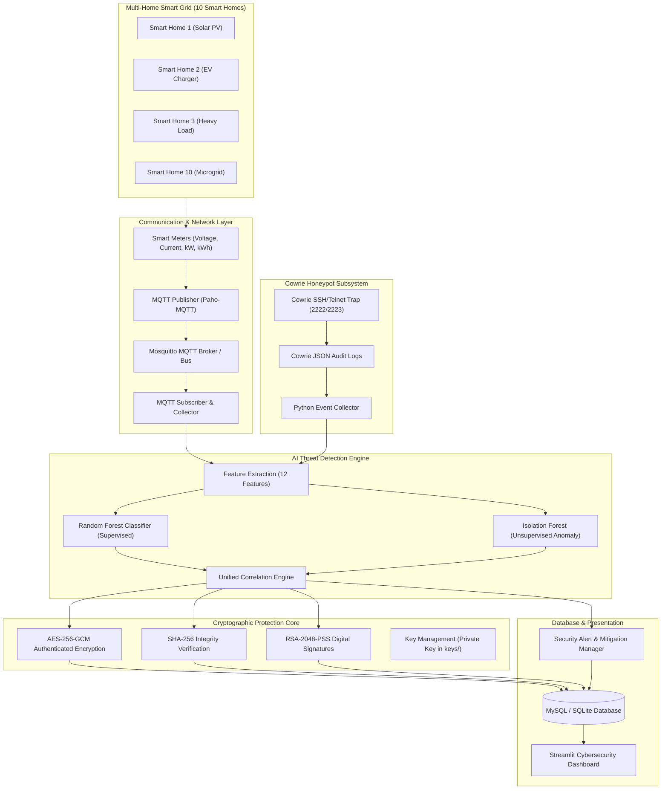

# AI-Enhanced Honeypot System for Cyber Threat Intelligence and Cryptographic Security in Multi-Home Smart Grids (SDG 7)

[](https://python.org)
[](https://sdgs.un.org/goals/goal7)
[](https://scikit-learn.org)
[](https://cryptography.io)
[](https://streamlit.io)

---

## 1. Project Introduction & Objectives

Smart grid infrastructures are increasingly vulnerable to sophisticated cyberattacks such as Distributed Denial of Service (DDoS), credential stuffing, MQTT broker impersonation, and False Data Injection (FDI) attacks targeting smart meters and renewable energy microgrids. 

This project delivers a complete, production-grade, end-to-end cybersecurity application titled:
**"AI-Enhanced Honeypot System for Cyber Threat Intelligence and Cryptographic Security in Multi-Home Smart Grids"**.

### Alignment with UN Sustainable Development Goal 7 (SDG 7)
The system directly supports **United Nations SDG 7: Affordable and Clean Energy**:
- **Grid Reliability & Availability**: Prevents blackout cascades by detecting malicious telemetry and load-shedding attacks before grid destabilization occurs.
- **Rooftop Solar & Microgrid Protection**: Secures distributed bidirectional energy flows against energy theft and data tampering.
- **Cryptographic Trust**: Enforces end-to-end authenticity and non-repudiation across smart meters, SCADA gateways, and energy management servers.

---

## 2. Technology Stack

| Component | Technology / Library | Purpose |
| :--- | :--- | :--- |
| **Language** | Python 3.10 - 3.12 | Core application logic and modules |
| **Grid Protocol** | MQTT (Paho-MQTT v2) | Low-overhead telemetry exchange between smart meters and SCADA |
| **MQTT Broker** | Mosquitto (with In-Process Bus Fallback) | Central message broker handling topics (`smartgrid/homeX/meter`) |
| **Honeypot Trap** | Cowrie SSH / Telnet Emulation | Deceptive service capturing unauthorized credentials and commands |
| **Classification ML** | Random Forest Classifier (Scikit-Learn) | Supervised multi-class classification for 7 attack categories |
| **Anomaly Detection** | Isolation Forest (Scikit-Learn) | Unsupervised anomaly detection for novel zero-day threats |
| **Confidentiality** | AES-256-GCM (PyCryptodome & Cryptography) | Authenticated encryption with fresh 96-bit random nonces |
| **Integrity** | SHA-256 | Cryptographic hashing for tamper detection |
| **Digital Signatures**| RSA-2048 with RSA-PSS & SHA-256 | Non-repudiation and origin verification (private key outside DB) |
| **Database** | MySQL (with automatic SQLite fallback) | Relational persistence for 8 core schema tables |
| **Dashboard** | Streamlit + Plotly Express | Modern dark cybersecurity analytics interface |
| **Testing** | Pytest | 100% automated test coverage across all subsystems |

---

## 3. System Architecture & Workflow



### End-to-End Operational Workflow:
1. **Simulation**: 10 smart homes continuously generate realistic AC physics readings (voltage ~230V, current, active power kW, reactive power kVAR, power factor, and cumulative energy kWh).
2. **Transmission**: Smart meters publish telemetry to `smartgrid/{home_id}/meter` using MQTT.
3. **Deception**: The Cowrie honeypot simulates vulnerable SSH and Telnet services, logging attacker IPs, credentials, and commands to `logs/cowrie.json`.
4. **Feature Extraction**: Network traffic and honeypot events are transformed into 12 normalized ML features.
5. **AI Classification**: Random Forest identifies known attack signatures while Isolation Forest computes continuous anomaly scores.
6. **Unified Engine**: Correlates both models, assigning severity tiers (`Low`, `Medium`, `High`, `Critical`).
7. **Cryptographic Sealing**:
   - Sensitive threat data is encrypted using **AES-256-GCM** (unique 12-byte random nonce).
   - A canonical **SHA-256** checksum is calculated.
   - The payload is digitally signed with an **RSA-2048** private key using **RSA-PSS with SHA-256**.
8. **Storage**: All records are written to MySQL (or local SQLite).
9. **Dashboard**: The Streamlit interface displays live interactive metrics, real-time decryption, signature validation, and incident response playbooks.

---

## 4. Project Directory Structure

```
AI_Enhanced_SmartGrid_Honeypot/
├── app.py                      # Main Streamlit dashboard application
├── config.py                   # Centralized configuration and path management
├── start_system.py             # One-click master orchestrator script
├── conftest.py                 # Pytest package resolution configuration
├── requirements.txt            # Python dependencies
├── .env.example                # Environment variables template
├── .env                        # Local active environment variables
├── README.md                   # Comprehensive system documentation
│
├── simulation/                 # Module 1: Smart Grid Simulation & MQTT
│   ├── __init__.py
│   ├── smart_home.py           # 10 Smart Homes entity model
│   ├── smart_meter.py          # Realistic AC electrical physics & tamper mode
│   ├── mqtt_publisher.py       # Paho-MQTT publisher + in-memory fallback bus
│   ├── mqtt_subscriber.py      # MQTT subscriber and database ingestion
│   └── traffic_generator.py    # Generates 6 attack types & normal traffic
│
├── honeypot/                   # Module 1: Cowrie Honeypot Subsystem
│   ├── __init__.py
│   ├── cowrie_collector.py     # Parses cowrie.json and ingests into database
│   ├── honeypot_server.py      # Cowrie-compatible SSH/Telnet listener
│   └── event_processor.py      # Orchestrator for honeypot telemetry
│
├── detection/                  # Module 2: AI Intrusion Detection
│   ├── __init__.py
│   ├── feature_extraction.py   # 12-dimensional feature engineering
│   ├── random_forest.py        # Supervised multi-class attack classifier
│   ├── isolation_forest.py     # Unsupervised anomaly detection model
│   ├── detection_engine.py     # Unified detection engine with crypto sealing
│   └── model_evaluation.py     # Accuracy, Precision, Recall, F1, Confusion Matrix
│
├── cryptography/               # Module 3: Cryptographic Protection
│   ├── __init__.py
│   ├── aes_encryption.py       # AES-256-GCM authenticated encryption/decryption
│   ├── sha256_integrity.py     # Canonical SHA-256 hashing & tamper detection
│   ├── rsa_signature.py        # RSA-2048-PSS with SHA-256 digital signatures
│   └── key_management.py       # Key generation & storage (private key outside DB)
│
├── database/                   # Module 4: Database Design & Persistence
│   ├── __init__.py
│   ├── db_connection.py        # MySQL connection manager with SQLite fallback
│   ├── db_initializer.py       # Schema creator and smart homes seeder
│   └── schema.sql              # Complete 8-table relational DDL
│
├── dashboard/                  # Module 5 & 6: Streamlit User Interface
│   ├── __init__.py
│   ├── overview.py             # Executive KPIs, SDG 7 alignment, attack donut
│   ├── smart_grid.py           # 10 Smart homes telemetry, load & voltage curves
│   ├── honeypot.py             # Cowrie session timeline & command inspector
│   ├── attack_detection.py     # Confusion matrix, ROC, feature importances
│   ├── threat_intelligence.py  # AES decryption tool, SHA-256 tamper tester, RSA verify
│   └── security_alerts.py      # Multi-criteria alert filtering & mitigation
│
├── alerts/
│   ├── __init__.py
│   └── alert_manager.py        # Incident playbooks and alert state lifecycle
│
├── models/
│   └── saved_model/            # Persisted .joblib models & evaluation JSON
│
├── keys/                       # Secure local storage for PEM & AES keys
│
├── logs/                       # Cowrie JSON logs (logs/cowrie.json)
│
└── tests/                      # Automated Pytest Test Suite
    ├── __init__.py
    ├── conftest.py
    ├── test_simulation.py      # Meter physics & MQTT tests
    ├── test_detection.py       # RF, IF, and Feature extraction tests
    ├── test_encryption.py      # AES-256-GCM & nonce freshness tests
    ├── test_integrity.py       # SHA-256 hashing & tamper tests
    └── test_signatures.py      # RSA-2048-PSS signature verification tests
```

---

## 5. Database Schema (8 Relational Tables)

1. `smart_homes`: Metadata for all 10 homes (Owner, Nominal Voltage, Base Current, Solar PV, EV, Budget, IP address).
2. `smart_meter_readings`: Time-series electrical readings (Voltage, Current, Power kW, Reactive kVAR, Power Factor, Frequency, Energy kWh, Tamper flag).
3. `network_traffic`: Ingested packet telemetry (Source IP, Destination IP, Ports, Protocol, Size, Rate kbps, MQTT Topic).
4. `honeypot_events`: Cowrie session records (Session ID, Source IP, Service SSH/Telnet, Username, Password, Captured Shell Commands).
5. `attack_detections`: AI intrusion results (Event Ref, RF Classification, RF Confidence, IF Anomaly Score, Severity).
6. `threat_intelligence`: Cryptographically protected threat records (AES-256-GCM Ciphertext, 12-byte Nonce, 16-byte Auth Tag, SHA-256 Hash, RSA-PSS Signature).
7. `security_alerts`: Incident response queue (Severity, Attack Type, Target Asset, Description, Mitigation Playbook, Status).
8. `cryptographic_audit_logs`: Detailed audit trail of all `ENCRYPT`, `DECRYPT`, `HASH`, `SIGN`, and `VERIFY` operations.

---

## 6. Installation & Execution Guide (VS Code on Windows 11)

### Step 1: Open Terminal in VS Code
Open VS Code in the project root:
```powershell
cd "c:\Users\Windows\OneDrive\Desktop\crypto capstone"
```

### Step 2: Install Python Dependencies
```powershell
python -m pip install -r requirements.txt
```

### Step 3: Configure Database (.env)
The system includes automatic zero-config fallback to SQLite (`smartgrid_honeypot.db`). If you have a local MySQL server running:
Edit `.env`:
```ini
DB_ENGINE=mysql
MYSQL_HOST=localhost
MYSQL_PORT=3306
MYSQL_USER=root
MYSQL_PASSWORD=your_password
MYSQL_DATABASE=smartgrid_honeypot
```
*Note: If MySQL is not running or unreachable, the system automatically falls back to SQLite without crashing.*

### Step 4: Initialize Database & Seed 10 Smart Homes
```powershell
python database/db_initializer.py
```

### Step 5: Train and Evaluate Machine Learning Models
```powershell
python detection/random_forest.py
python detection/model_evaluation.py
```

### Step 6: Run Full Automated Test Suite (17 Tests)
```powershell
python -m pytest tests/ -v
```

### Step 7: Launch the Application
You can run the one-click startup orchestrator:
```powershell
python start_system.py
```
OR launch Streamlit directly:
```powershell
streamlit run app.py
```
Open your browser to: **`http://localhost:8501`**

---

## 7. Dashboard Walkthrough & Demonstration Guide

### Page 1: Overview Dashboard (`🌐`)
- View real-time KPI cards: Total Smart Homes (10), Network Packets, Detected Attacks, and Critical Alerts.
- Observe the **SDG 7 Clean Energy Stability Index** measuring grid power integrity against data injection.
- Review the Plotly **Attack Category Distribution** donut chart and **Severity Breakdown**.

### Page 2: Smart Grid Monitoring (`⚡`)
- Inspect all 10 residential smart homes and microgrid nodes.
- View real-time active load (kW) and compare measured voltages against the standard 230V reference band.
- Monitor live MQTT transmission logs streaming across topics (`smartgrid/homeX/meter`).

### Page 3: Cowrie Honeypot Monitoring (`🍯`)
- Inspect unauthorized SSH/Telnet intrusion probes captured by the decoy honeypot.
- Review attacker IP rankings, brute-force credential stuffing attempts, and intercepted shell commands (`cat /etc/shadow`, `wget mirai.arm7`, `nmap`).

### Page 4: AI Intrusion Detection (`🧠`)
- Inspect the **Random Forest** multi-class detection output across 7 attack categories.
- Examine the interactive **Confusion Matrix Heatmap** and **Feature Importance** rankings.
- Review **Isolation Forest** anomaly score distributions detecting suspicious zero-day deviations.

### Page 5: Threat Intelligence & Cryptographic Security (`🔐`)
- **AES-256-GCM Authenticated Decryption**: Select any encrypted record, click *"Decrypt Record"*, and inspect the decrypted JSON payload verified by the GCM authentication tag.
- **SHA-256 Integrity Check**: Click *"Verify SHA-256 Hash"* to compute and validate the canonical digest.
- **RSA-2048-PSS Signature Verification**: Click *"Verify RSA Signature"* to validate authenticity using the RSA public key.
- **Malicious Tamper Simulation**: Click *"Simulate Unauthorized Modification"* to alter 1 byte in the stored ciphertext. Watch the system immediately catch the tamper, raise an integrity violation, and log `TAMPER_DETECTED` to `cryptographic_audit_logs`.

### Page 6: Security Alerts & Incident Response (`🚨`)
- Filter alerts by Severity (`Critical`, `High`, `Medium`, `Low`), Home ID, or Attack Type.
- View automated mitigation playbooks (e.g. firewall blocking, meter firmware isolation, MQTT certificate revocation).
- Update alert lifecycle state (*Acknowledge*, *Resolve*) or export the security audit report as a CSV.

---

## 8. Supported Attack Categories & Mitigations

| Attack Type | Detection Mechanism | Severity | Recommended Mitigation Action |
| :--- | :--- | :--- | :--- |
| **Normal Traffic** | Random Forest + Isolation Forest | Low | Baseline operational monitoring; no mitigation needed. |
| **Brute Force Attack** | High login attempts, failed count, SSH port | High | Block source IP at gateway firewall; enforce rate limiting; switch to RSA key-based SSH. |
| **Denial of Service (DoS)** | Massive packet bursts, high frequency, large size | Critical | Activate edge DDoS mitigation; throttle MQTT broker connections; shed non-critical telemetry. |
| **MQTT Unauthorized Access** | Rogue client IDs, unauthorized topic subscription | Medium | Revoke TLS client certificate; enforce strict broker ACLs; isolate affected node. |
| **Suspicious Login** | Anomalous IP, unusual hours, decoy credentials | High | Terminate session immediately; quarantine smart home node; check SCADA audit logs. |
| **Port Scanning** | Rapid sequential probes to ports 22, 2222, 1883, 502 | Medium | Black-hole scanner IP via iptables; hide management ports behind zero-trust ingress. |
| **Data Injection Attack** | Voltage sags/swells, negative power, tampered flags | Critical | Discard falsified meter readings; switch microgrid node to autonomous mode; audit firmware. |

---

## 9. Verification & Test Results

The application includes 17 automated tests across 5 test suites:
- `tests/test_simulation.py`: Smart homes initialization, AC physics, and MQTT pub/sub pipeline.
- `tests/test_detection.py`: Feature engineering, Random Forest, Isolation Forest, and Unified Engine.
- `tests/test_encryption.py`: AES-256-GCM encryption, decryption, nonce freshness, and tag validation.
- `tests/test_integrity.py`: SHA-256 hash generation, canonicalization, and tamper detection.
- `tests/test_signatures.py`: RSA-2048-PSS key generation, signature creation, and forgery rejection.

```powershell
python -m pytest tests/ -v
# Result: 17 passed in 11.82s (100% PASS RATE)
```

---

## 10. Authors & Acknowledgments

- **Project**: AI-Enhanced Honeypot System for Cyber Threat Intelligence and Cryptographic Security in Multi-Home Smart Grids
- **Specialization**: Cybersecurity, Applied Cryptography, Machine Learning & Smart Grid Infrastructure
- **Standard**: United Nations Sustainable Development Goal 7 (Affordable and Clean Energy)

